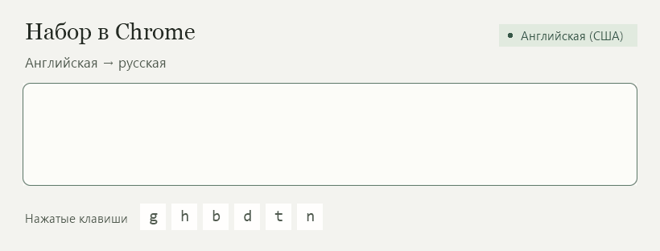
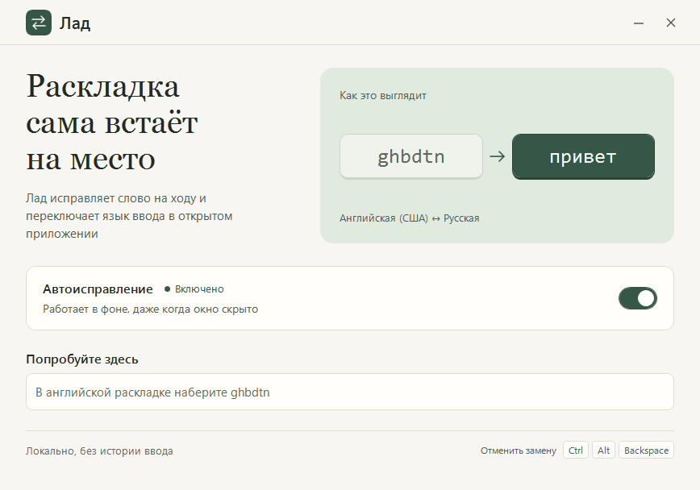
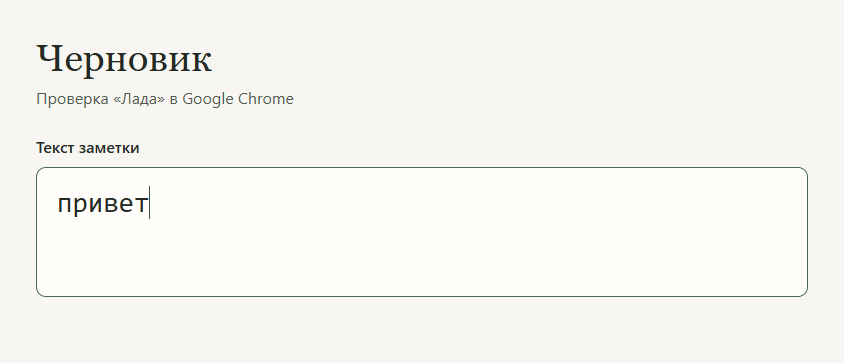

# Лад

Лад автоматически исправляет раскладку при наборе в Windows. При ошибке Лад заменит слово и переключит язык ввода. Поддерживаются стандартные русская и английская (США) раскладки.

**[Скачать Lad.exe для Windows x64](https://github.com/icefprogs/lad/releases/latest/download/Lad.exe)** · [Все версии](https://github.com/icefprogs/lad/releases)

## Автоисправление в действии

| Активная раскладка | Что набрано | Что получается |
| --- | --- | --- |
| Английская | `ghbdtn` | привет |
| Русская | руддщ | `hello` |

Если совпадение уверенное, Лад исправляет слово прямо на ходу. В остальных случаях он проверяет слово при наборе пробела или другого разделителя.

## Как пользоваться

1. Скачайте и запустите `Lad.exe`. Среда .NET уже включена.
2. Проверьте исправление в поле «Попробуйте здесь» или наберите текст в обычном поле Windows, например в заметке в Chrome.
3. Чтобы вернуть исходное слово и раскладку сразу после замены, нажмите **Ctrl + Alt + Backspace**.

Крестик скрывает окно в трей. Из меню значка можно открыть окно, поставить исправление на паузу или выйти. Для запуска сразу в трее используйте `Lad.exe --tray`.

Сопоставление выполняется локально. История ввода не сохраняется. Поля паролей пропускаются.

## Скриншоты

**Главное окно с настройкой автоисправления и пробным полем**

**Результат автоисправления в отдельном текстовом поле Google Chrome**

Словари основаны на [FrequencyWords](https://github.com/hermitdave/FrequencyWords/tree/525f9b560de45753a5ea01069454e72e9aa541c6) и распространяются по [CC BY-SA 4.0](https://creativecommons.org/licenses/by-sa/4.0/).

